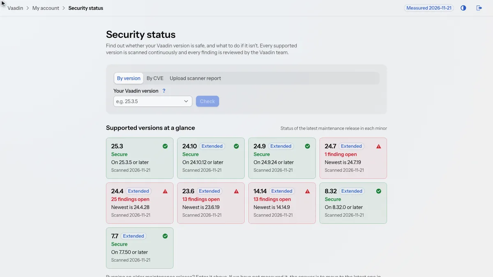
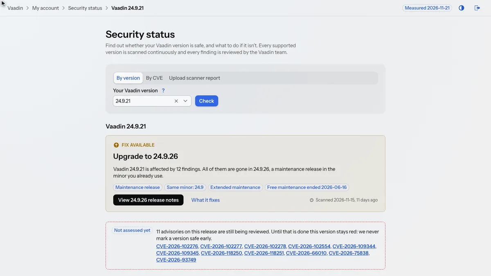
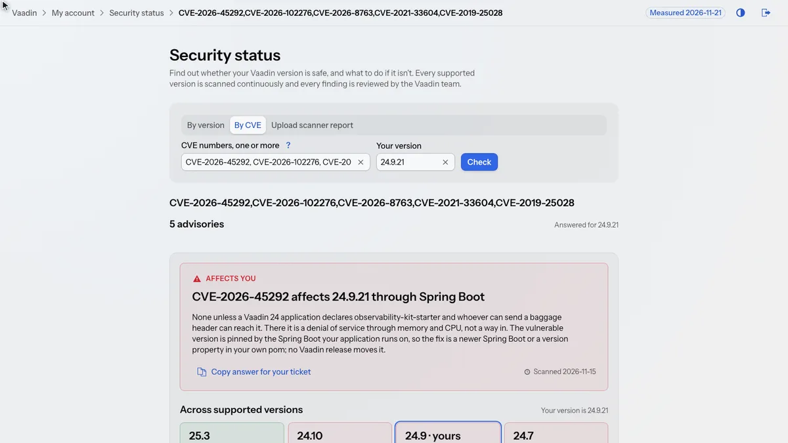
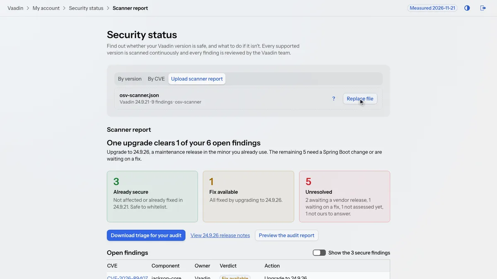
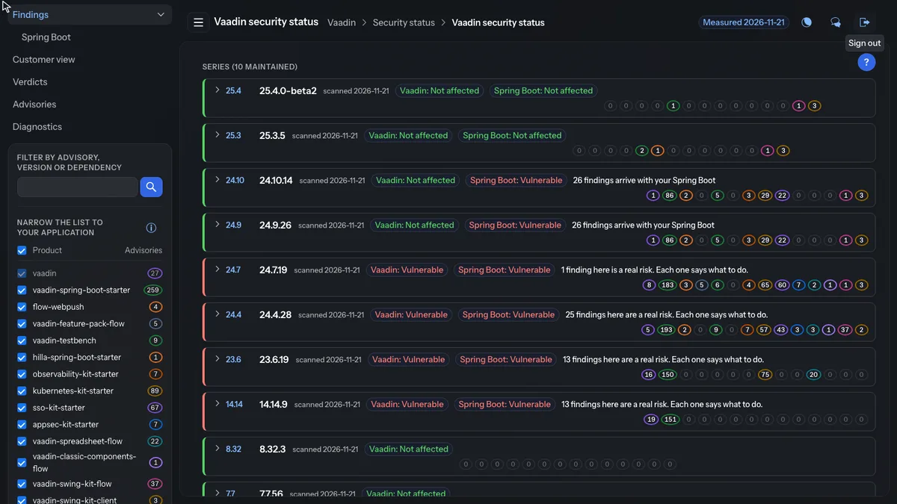
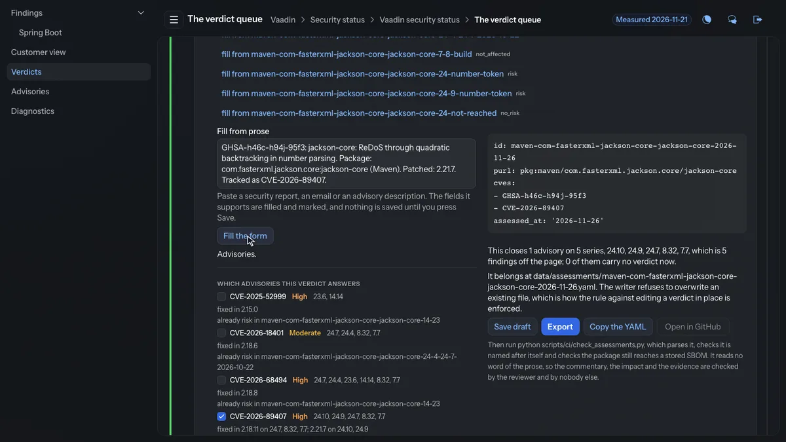
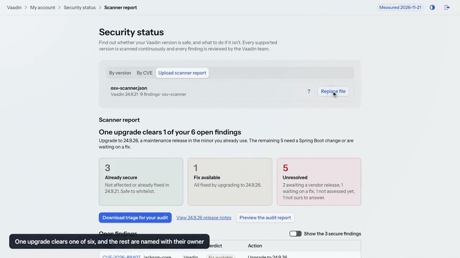
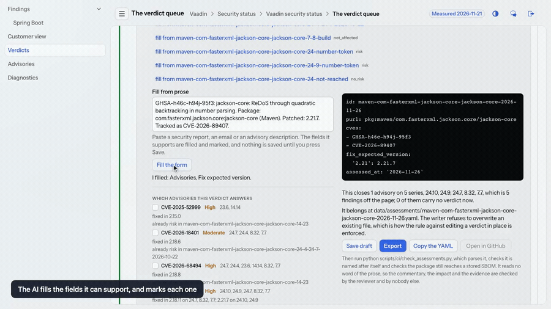

# Security Status 25.4

A rebuild of Vaadin's two security status pages on Vaadin 25.4, built specification first, for the 25.4 hackathon. Two goals:

1. **Turn the prototype into a production ready Vaadin application** that can be served from vaadin.com.
2. **Cover the new features of Vaadin 25.4** and report the bugs and issues found on the way.

The originals live in vaadin/cve-status: two static JavaScript pages on GitHub Pages that compute everything in the reader's browser from the published JSON. One answers customers ("is my Vaadin version safe, and what do I do?"), the other is the security team's findings explorer behind a client side gate. This application answers the same questions from the same JSON as one Vaadin Flow application, with a real sign in, real addresses, server side parsing of scanner reports, and two things the originals do not have: an AI assistant for the team and a diagnostics board.

Nothing is copied from the JavaScript code. It was read for behaviour only.

## How it was built

1. **Specifications first.** One prompt in plan mode produced `specs/`: an overview, the cross cutting documents and thirteen epics with acceptance criteria and named test cases. The brief is `specs/PROMPT.md`. The specs carried one standing order: write down every bug, missing API and workaround as you hit it.
2. **Thirteen epics, unattended.** One agent session per epic, from 20 to 22 November, each closing with its gate green and every decision it took on its own written to `DECISIONS.md`, with how to revert it.
3. **Aligned with the live prototype.** Seven more sessions compared every screen with the live pages on the same data and moved the app to the prototype's layout and wording.
4. **Polished by hand.** With the dev loop running, view by view in the browser and on a phone, through `DECISIONS.md` and `NEEDS-A-PERSON.md` together with the agent.
5. **Findings to issues.** Every row in `specs/FEEDBACK-25.4.md` was reduced to a minimal project, searched for duplicates and posted only after review. The pipeline is `specs/issues/README.md`.

## Running it

```bash
./mvnw                       # the application on 8080, reading the published JSON
./mvnw verify                # unit and browserless tests: no licence, no key, no network
./mvnw verify -Pit           # adds the browser tests
OPENAI_API_KEY=... ./mvnw    # the assistant with a live model, the ai profile turns on by itself
```

Every page asks for a sign in. Use `team` / `team` for the team's pages or `guest` / `guest` for a reader without the role; they are demo accounts of the default `demo` profile and they are in the source on purpose. Against vaadin.com's own single sign on, run the `cas` profile instead, where a verified vaadin.com email is what grants the team role. Without a key the assistant replays recorded answers in development and is not offered in production. `DEMO.md` is the walk through, and [Running it in detail](#running-it-in-detail) at the end covers the dev loop, mock data, keys and production.

## How to use it

The pictures on this page predate the restyle to the prototype's look of 28 November, D-264 to D-278, so the screens now look closer to the live prototype than they show.

Two halves behind one sign in. A customer asks one question and gets an answer; the security team reads the measurements behind every answer and writes the verdicts that produce them. The walk below is the two minute version of `DEMO.md`.

### As a customer



Sign in as `guest`, on a card that stands alone, outside the application's frame. The front page answers before you ask anything: one card per maintained minor, tinted by state, with its newest release and when it was scanned. There are three ways to ask about your own application, and they are the three tabs of the box at the top.

**Type your version.** This is the common one, and the answer is a single card: secure, a fix available, or unresolved. Fix available names the release to move to and lists, advisory by advisory, what that move clears. Nothing on the page is wording the measurements do not carry.



**Paste advisory ids.** One or several, with or without your version. Each gets its own answer in the words the question deserves: fixed in a named release, affects you through Spring Boot, not assessed yet, does not affect you. "Copy answer for your ticket" puts the card's own words on the clipboard, which is what a support reply needs.



**Upload the report your scanner produced.** CycloneDX, OWASP Dependency-Check, osv-scanner or bomber. The server reads it, never stores it, and answers with what one upgrade would clear and who has to move on the rest: Vaadin, Spring Boot, the library, or you. The triage leaves as a CSV or as a PDF you can preview first.



### As the security team

Sign in as `team`. Four more pages appear, and the assistant with them.



**`/findings`** is the map: every maintained line, with the Vaadin and the Spring Boot half of each kept apart, and a filter that narrows everything to the products an application actually declares. What you turn off is written into the address, so a narrowed view can be sent to somebody.

**`/findings/workbench`** is where the work is decided. The queue is one row per package, ranked by how much a single verdict would close. A package that already carries verdicts opens with the form filled from the newest of them, D-278. Paste a security report into the form and the AI fills the fields it can support, marking each one; the YAML follows the typing, and nothing is saved, and nothing reaches GitHub, until a person presses the button.



**The assistant** answers from the same measurements and says which file it read. It refuses rather than guesses: ask it something the data cannot settle and it says the measurements do not say.

**`/diagnostics`** is the board, fed by the navigation and request events of the service event bus, so it counts the walk you just did.

### Watch it instead

A scanner report dropped in, read on the server, and answered:



A security report pasted into the workbench, filling the verdict the team is about to write:



Those two are the moments worth seeing. The whole of each walk is a video, which GitHub will not play inside this page and offers as a download: [the customer half](demo/video/customer.mp4), 1:08, and [the team half](demo/video/team.mp4), 2:40.

All of it is made by the two scripts in `demo/`, against the committed fixtures rather than live data, so every number is the same on every run, and neither of them presses anything that writes.

## What to look at

| Route | What it shows |
| --- | --- |
| `/` | The customer page: supported versions and the lookup by version, by CVE or by scanner report |
| `/version/24.9.21` | The answer for one version: the verdict card, the upgrade, Spring Boot findings, details |
| `/cve/CVE-2026-45292/24.9.21` | The answer for one advisory on one version, with a copyable answer |
| `/scan` | A scanner report (CycloneDX, Dependency Check, OSV Scanner, bomber) triaged on the server, with CSV and PDF |
| `/advisories` | The advisory catalogue with verdict filters and a per row context menu |
| `/findings` | Team: the findings explorer, series by series, filtered by product |
| `/findings/workbench` | Team: the verdict queue, the form, drafts shared by the team, the handover to GitHub |
| `/diagnostics` | Team: navigation, request and session counts from the service event bus, as a board |
| The chat icon | Team: the assistant, with tools over the same data and a photo from the phone's camera |

## What 25.4 it exercises

Signals end to end (`SharedValueSignal`, effects bound to a component's life, `bindVisible`, `bindChildren`), the AI orchestrator with tools, Grid AI and Form AI, `UploadCapture` for the phone camera, the modular upload (`UploadManager`, `UploadButton`, `UploadDropZone`), the `Download` API and the PDF Viewer, `GridContextMenu.setDynamicContentProvider`, FormLayout side labels, `NativeForm`, the navigation and request events on the service event bus, declared JavaScript with `@JsExpression`, the Dashboard, SideNav and Breadcrumbs, Aura with light and dark, browserless tests on JUnit 6, and the dev loop CLI. On Spring Boot 4 and Java 21.

## Two UIs, one removable

The code is split so the team's half can be deleted if it is not wanted:

The shared part is `data`, `security` and `ui/common`: the Pages client and cache, Spring Security and the CSP, and what both UIs draw. The customer's part is `customer` and `ui/customer`, its rules and its views. The team's part is `team` and `ui/team`: the explorer, the workbench, the assistant and diagnostics.

Delete `team/`, `ui/team/`, `styles/team/` with its imports in `styles.css`, the team's tests and the team's specifications, and the application still builds and serves the customer pages. `TeamIsRemovableTest` keeps it that way, and `DEVELOPMENT.md` has the steps.

## The issues this build opened

Sixteen issues and six comments on existing ones, each issue with a reproducer project zipped under `specs/issues/projects/`, and one fix. They carry the `Hackathon 25.4:` prefix, or `PiT 25.4:` for a finding older than this release, and are listed in the platform tracker, https://github.com/vaadin/platform/issues/9642.

**vaadin/flow**

- [#27159](https://github.com/vaadin/flow/issues/27159) Since 25.0 the bootstrap page is served without the headers Spring Security writes
- [#27160](https://github.com/vaadin/flow/issues/27160) A shared signal changed by another thread before a component is attached never reaches its bindings
- [#27172](https://github.com/vaadin/flow/issues/27172) QueryParameters could keep the order the parameters were given in
- [#27173](https://github.com/vaadin/flow/issues/27173) The error callback of the Clipboard API takes a type from an internal package
- [#27187](https://github.com/vaadin/flow/issues/27187) A signal effect runs without the session lock when a RequestEndedEvent listener changes a shared signal
- [#27490](https://github.com/vaadin/flow/issues/27490) AuthenticationContext.logout() sends the browser to the host's root when a proxy serves the application under a path

**vaadin/flow-components**

- [#10752](https://github.com/vaadin/flow-components/issues/10752) Button refuses bindEnabled beside disable on click, also in the new UNTIL_RESPONSE mode
- [#10753](https://github.com/vaadin/flow-components/issues/10753) GridAIController cannot narrow a grid the application already has
- [#10754](https://github.com/vaadin/flow-components/issues/10754) A failed AI turn writes a fixed English sentence the application cannot replace
- [#10755](https://github.com/vaadin/flow-components/issues/10755) Breadcrumbs in ROUTER mode cannot show an item that is not a route of the application
- [#10779](https://github.com/vaadin/flow-components/issues/10779) ComboBox.bindValue before setItems drops the bound value, with only a log line

**vaadin/web-components**

- [#13535](https://github.com/vaadin/web-components/issues/13535) Aura's app layout inset is 1.5vmin unrounded, so the drawer's content sits on fractions of a pixel, posted as PiT 25.4 because it is the same since 25.0, with the fix in [#13534](https://github.com/vaadin/web-components/pull/13534)

**vaadin/browserless-test**

- [#383](https://github.com/vaadin/browserless-test/issues/383) A file served by Download.onClick cannot be fetched from a test, as an Anchor's can
- [#384](https://github.com/vaadin/browserless-test/issues/384) GridContextMenuTester cannot open a menu that uses the 25.4 dynamic content provider

**vaadin/docs**

- [#6739](https://github.com/vaadin/docs/issues/6739) The @Uses note on the production build page covers reflection only, and an injected component is left out the same way

**vaadin/spec-driven-development-demo**

- [#39](https://github.com/vaadin/spec-driven-development-demo/issues/39) architecture.md describes React views, Spring Security and JUnit 5 that the generated project does not have

**Comments on existing issues**, where 25.4 still shows the behaviour or adds a case: [flow#25576](https://github.com/vaadin/flow/issues/25576#issuecomment-7094873357), [flow#26338](https://github.com/vaadin/flow/issues/26338#issuecomment-7094821340), [flow#26391](https://github.com/vaadin/flow/issues/26391#issuecomment-7094873718), [flow#5473](https://github.com/vaadin/flow/issues/5473#issuecomment-7088108706), [browserless-test#29](https://github.com/vaadin/browserless-test/issues/29#issuecomment-7094696694), [docs#6495](https://github.com/vaadin/docs/pull/6495#issuecomment-7082927999).

Five more findings died on the way: three were already documented, two were already being fixed in open documentation pull requests. They are kept in `specs/issues/README.md` with the reason.

## Where to read more

| File | Contents |
| --- | --- |
| `specs/` | The contract, written before the code. Start at `specs/00-overview.md` |
| `specs/FEEDBACK-25.4.md`, `specs/FEEDBACK-PLATFORM.md` | Every missing API, bug and workaround, in 25.4 and older |
| `DECISIONS.md` | 278 decisions, each with why and how to revert it |
| `REPORT.md` | How the build went, the timeline, the comparison with the originals, what is not done |
| `DEMO.md` | The demo, step by step |
| `DEVELOPMENT.md` | Development notes, the licence, removing the team |

## Running it in detail

### Development mode or the dev loop

```bash
./mvnw                          # development mode on http://localhost:8080
./mvnw vaadin:install-dev-cli   # once: installs the dev loop
.vaadin/vaadin-dev start        # the dev loop owns the application
.vaadin/vaadin-dev apply        # after an edit: compiles and hot swaps, the exit code says whether it is live
.vaadin/vaadin-dev stop
```

Use one or the other: both take port 8080. To pass environment variables or Maven profiles to the dev loop, set them before `start`, for example `VAADIN_DEV_DAEMON_OPTS="-Dvaadin.dev.mavenArgs=-Pai"`. The daemon keeps the environment it was first started with, so to change a variable run `.vaadin/vaadin-dev shutdown` before `start`; `stop` alone is not enough.

### Real data or mock data

By default the application reads the real data, the JSON vaadin/cve-status publishes at `https://vaadin.github.io/cve-status/`, and revalidates it every 15 minutes.

For mock data, serve the test fixtures and point the application at them. The numbers are then fixed, measured on 2026-11-21, which is what `DEMO.md` describes:

```bash
mkdir -p /tmp/pages && ln -sfn "$PWD/src/test/resources/pages" /tmp/pages/cve-status
(cd /tmp/pages && python3 -m http.server 8082 --bind 127.0.0.1) &
SECURITYSTATUS_PAGES_BASE_URL=http://localhost:8082/cve-status/ ./mvnw
```

### Keys, tokens and settings

| Setting | What it does | Without it |
| --- | --- | --- |
| `OPENAI_API_KEY` | Turns the `ai` Maven profile on by itself and the assistant answers with a live model | Development replays recorded answers; production does not offer the assistant |
| Vaadin licence, `~/.vaadin/proKey` or `offlineKey` | The PDF Viewer and the Dashboard are commercial; the production build requires it | Development shows the trial dialog over those two; the tests pass anyway |
| `SECURITYSTATUS_PAGES_BASE_URL` | Where the data is read from | The published JSON |
| `SECURITYSTATUS_DRAFTS_DIR` | Where the workbench keeps its drafts, an H2 file | `~/.security-status` |
| `PORT` | The HTTP port | 8080 |

The accounts are `team` / `team` and `guest` / `guest`, from the `demo` profile that is the default; `SECURITYSTATUS_DEMO_TEAM_NAME`, `_TEAM_PASSWORD`, `_GUEST_NAME` and `_GUEST_PASSWORD` in the environment replace them. `-Dspring.profiles.active=cas` signs in through sso.vaadin.com instead, and `cas-local` against staging; a production start with neither named refuses to run.

### Production

```bash
OPENAI_API_KEY=... ./mvnw clean package -Pproduction
OPENAI_API_KEY=... java -jar target/security-status-*.jar
```

The key is needed at build time too, because it is what brings the model's library into the jar. Not production ready yet:

- **The single sign on has never met the real server.** The `cas` profile is built and tested against a stubbed ticket validator only. What it still needs from the vaadin.com web team is P-21 in `NEEDS-A-PERSON.md`: the service path, whether CAS releases `emailAddressVerified`, single log out, and the customer rule.
- **Drafts live in an H2 file on the local disk.** More than one instance, or a container without a mounted volume, loses them; production needs a shared database.
- **The versions are prereleases.** Vaadin 25.4.0-beta2 and Spring Boot 4.2.0-RC2, from the prerelease repository, and the Docker base images are not pinned by digest. P-22.

A demonstration copy runs at https://v-herd.eu/security-status, rebuilt from the `manolo` branch on every push, with the `demo` profile, its accounts set through the environment, and the assistant on a live model. Its licence comes as the `proKey` build argument; a server licence key does not cover `vaadin-pdf-viewer` 25.4.0-beta1, and without a key it shows Vaadin's commercial banner. `DEVELOPMENT.md` has the build arguments it uses.

## Hackathon

- Platform version: 25.4.0-beta2
- Slack: #hackathon-25-4
- Documentation: https://vaadin.com/docs/next/
